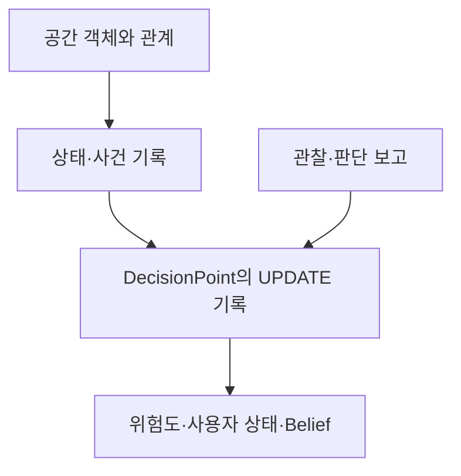

# XRMemory Scene Graph

제어판의 공간 구성, 화면 상태 변화, 작업자의 관찰·판단·행동을 연결하는 설계 문서와 JSON 예시입니다.

현재 버전은 **v0.1.0 설계 초안**입니다. 모든 예시는 설명용 데이터이며 실측 결과가 아닙니다. 자동 사용자 상태 추론기는 포함하지 않습니다.

## 구조

| 구분 | 필드 | 내용 |
|---|---|---|
| 공간 구성 | `objects`, `relations` | 제어판·화면·영역·버튼과 포함·기능 관계 |
| 작업자 | `humans` | 익명 ID와 숙련도 |
| 시간 기록 | `states`, `events` | 화면 상태와 오류음·버튼 조작 |
| 관찰·판단 | `observations`, `interpretation` | 작업자가 보고한 단서와 판단 |
| 판단 지점 | `decision_graph` | DP1~DP5, NEXT, UPDATE.records |
| 공통 정보 | `metadata` | 버전·예시 여부·시간 기준·좌표계 정의 상태 |



## 문서

- [공간 구조와 필드](docs/design.md)
- [Decision 구조와 연결 방법](docs/decision.md)
- [시나리오](docs/scenario.md)
- [Query → Output 예시](docs/queries.md)
- [필수 촬영 정보](docs/capture-guide.md)
- [미정 사항](docs/open-questions.md)
- [출처와 변경 내역](docs/sources.md)
- [GitHub 업로드 방법](docs/github-upload.md)

## 예시 파일

- [통합 JSON](examples/p4_cutting_error.json): PDF 사례에 Decision Graph 연결
- [PDF 기준 JSON](examples/p4_cutting_error.source.json): 원래 구조 보존
- [HTML 합성 입력](examples/dp5_underreaction.synthetic.json): 절단 유지 사례
- [HTML 예상 갱신](examples/dp5_underreaction.expected.json): 실행 결과가 아닌 예상값
- [Decision 원문 정의](config/decision-design.source.json): HTML 내부 JSON 전체

통합 JSON의 `P4`는 시나리오 이름이고 `DP5`는 절단 중 판단 지점입니다. 서로 다른 ID 체계입니다.

## 검증

Python 3.10 이상, 외부 패키지 없이 저장소 루트에서 실행합니다.

```bash
python tools/validate.py
```

JSON 문법, 객체·기록 참조, 시간 순서, NEXT·UPDATE 구성을 검사합니다. 관측의 진실성이나 추정 규칙의 타당성을 검증하는 도구는 아닙니다.

## 범위

공간 관계와 작업자의 실행·판단 기록은 별도로 관리합니다. `effects`는 기대 효과, `states`는 기록된 화면값입니다. 화면값으로 실제 가스 상태를 단정하지 않습니다.

이 저장소는 독립적인 XRMemory 설계안이며 다른 SceneGraph 저장소의 스키마와 직접 호환된다고 가정하지 않습니다.
