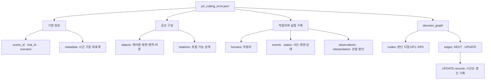
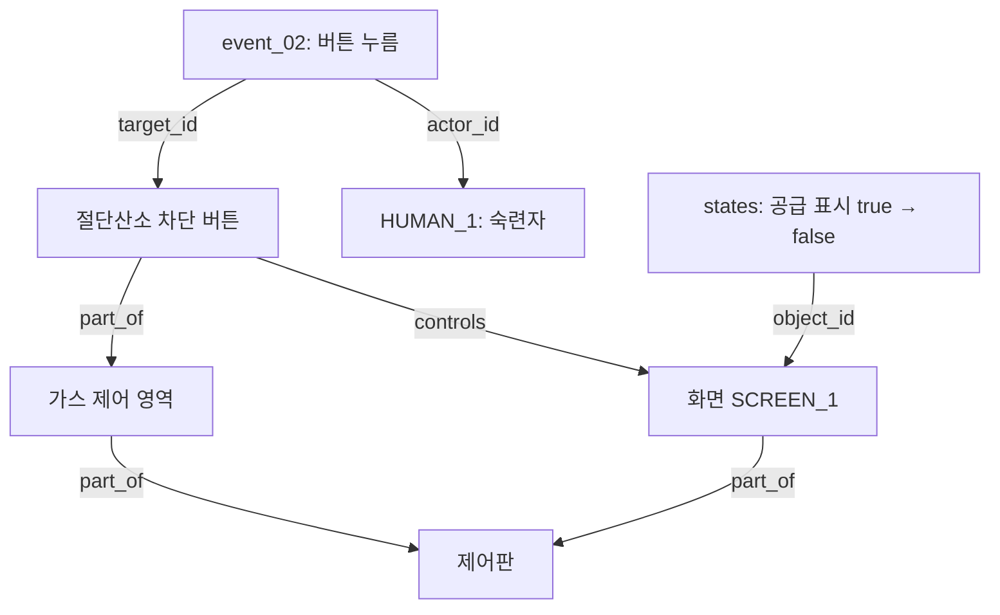
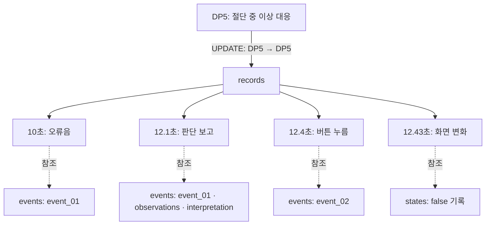

# XRMemory Scene Graph

제어판의 공간 구성과 작업자의 관찰·판단·조작 기록을 연결하는 데이터 구조.

현재 버전: **v0.1.0** · 촬영 전 설계안

## 구조

한 JSON에 공간 구성, 실험 기록, Decision 그래프를 담는다. 아래 분류는 설명용이며 각 필드는 JSON 최상위에 있다.



### 공간과 행동 연결

절단산소 차단 버튼에 관련된 객체와 기록만 표시했다. 실선의 이름은 관계 유형 또는 참조 필드다.



### Decision 기록 연결

NEXT는 DP1~DP5의 절차 순서다. UPDATE는 판단 지점의 갱신 기록이며, 이 예시에서는 DP5 → DP5 에지 하나에 네 기록을 쌓는다. 점선은 기존 JSON 기록에 대한 참조다.



| UPDATE 기록의 필드 | 내용 |
|---|---|
| `time_ms`, `previous_event_id` | 기록 시각과 이전 UPDATE 기록 ID |
| `observation.evidence_refs` | 사건·관찰·판단·상태 기록의 참조 |
| `inference` | 기준 위험도, 사용자 상태 추정, Belief |

12.1초의 HIGH 직접 보고를 Belief에 반영했다. 기준 위험도와 사용자 상태 추정은 근거 부족으로 UNKNOWN이다. DP1~DP4는 절차 정의만 있고 UPDATE 기록은 DP5에만 있다.


## 문서

- [공간 구조](docs/design.md)
- [Decision Graph](docs/decision.md)
- [시나리오](docs/scenario.md)
- [쿼리 예시](docs/queries.md)
- [촬영 가이드](docs/capture-guide.md)
- [논의 사항](docs/open-questions.md)
- [참고 자료](docs/sources.md)
- [업로드 방법](docs/github-upload.md)

## 데이터 예시

| 파일 | 내용 |
|---|---|
| [p4_cutting_error.json](examples/p4_cutting_error.json) | 공간 기록과 Decision Graph를 연결한 예시 |
| [p4_cutting_error.source.json](examples/p4_cutting_error.source.json) | 공간 그래프 원본 예시 |
| [dp5_underreaction.synthetic.json](examples/dp5_underreaction.synthetic.json) | 이상이 악화돼도 절단을 유지하는 합성 입력 |
| [dp5_underreaction.expected.json](examples/dp5_underreaction.expected.json) | 합성 입력의 예상 출력 |
| [decision-design.source.json](config/decision-design.source.json) | Decision 구조·규칙 원문 |

시간·좌표·판단 기록은 설명용 예시다. 쿼리 및 상태 추론 기능은 아직 구현하지 않았다.

## 검증

Python 3.10 이상. 외부 패키지 설치 없이 저장소 루트에서 실행한다.

```bash
python tools/validate.py
```

JSON 문법, ID 참조, 시간 순서, Decision 연결을 검사한다.
