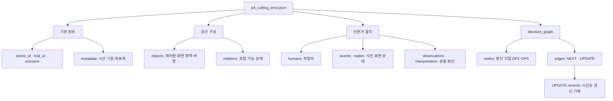
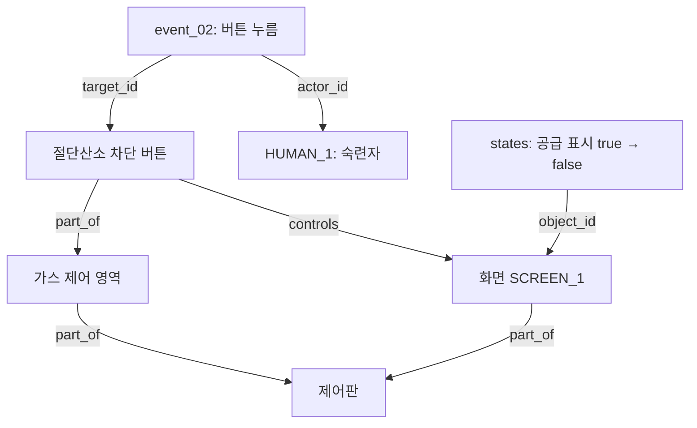
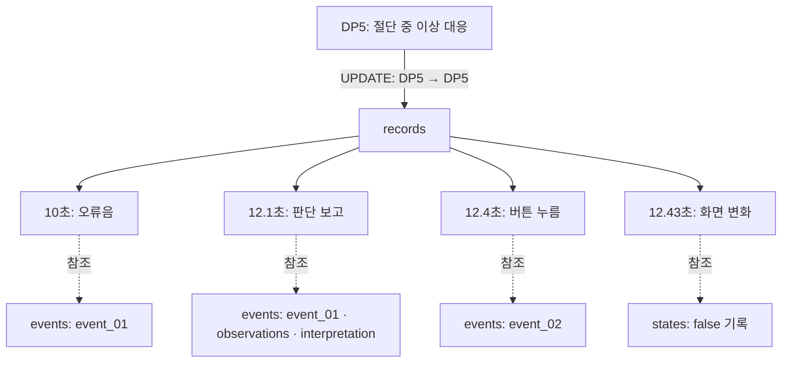
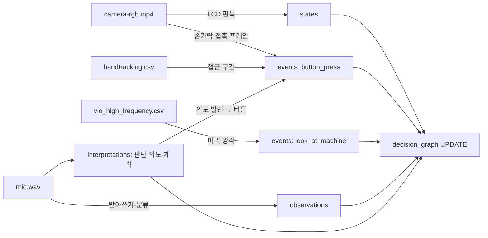

# XRMemory Scene Graph

제어판의 공간 구성과 작업자의 관찰·판단·조작 기록을 연결하는 데이터 구조

## 구조

### 공간과 행동 연결

절단산소 차단 버튼에 관련된 객체와 기록만 표시했다. 실선의 이름은 관계 유형 또는 참조 필드다.

### Decision 기록 연결

NEXT는 DP1~DP5의 절차 순서다. UPDATE는 판단 지점의 갱신 기록이며, 이 예시에서는 DP5 → DP5 에지 하나에 네 기록을 쌓는다. 점선은 기존 JSON 기록에 대한 참조다.

| UPDATE 기록의 필드 | 내용 |
|---|---|
| `time_ms`, `previous_event_id` | 기록 시각과 이전 UPDATE 기록 ID |
| `observation.evidence_refs` | 사건·관찰·판단·상태 기록의 참조 |
| `inference` | 기준 위험도, 사용자 상태 추정, Belief |

12.1초의 HIGH 직접 보고를 Belief에 반영했다. 기준 위험도와 사용자 상태 추정은 근거 부족으로 UNKNOWN이다. DP1~DP4는 절차 정의만 있고 UPDATE 기록은 DP5에만 있다.

## 실제 녹화 예시: Aria 261104_test0

Project Aria 안경으로 녹화한 정상 절차 시행(9분 25초)에서 같은 구조로 추출한 씬그래프다. 영상·손 추적·머리 방향·구술(think-aloud)을 근거로 DP1~DP5 전체에 UPDATE 기록 56건이 쌓인다.

| 파일 | 내용 |
|---|---|
| `examples/aria_261104_test0/scenegraph.json` | 추출된 씬그래프 |
| `examples/aria_261104_test0/annotation.json` | 수작업 주석 (화면 전환 프레임, 교정·분류한 발언) |
| `examples/aria_261104_test0/mic_script.md` | 구술 대본 |
| `tools/aria/` | 생성·받아쓰기 스크립트 |
| `viewer/index.html` | 추출 과정 시각화 (`python3 -m http.server` 후 `/viewer/`) |
| `docs/aria-extraction.md` | 추출 방법, 스키마 확장, 가정 |
